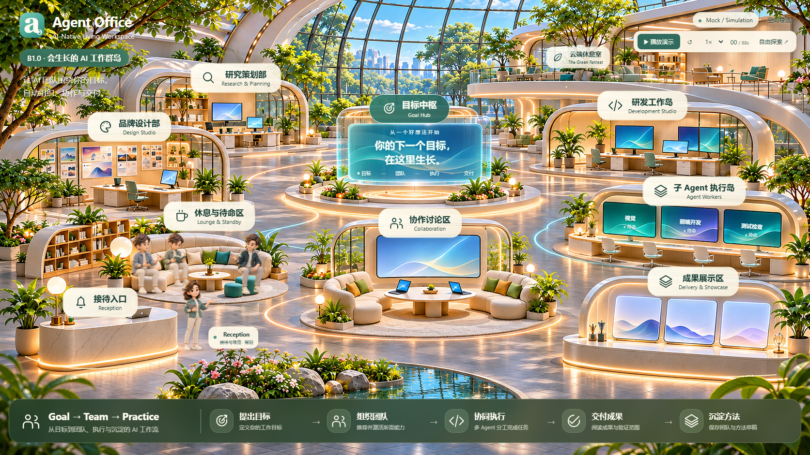

# Agent Office · B1.0 Living Office

> Status: ACTIVE · 2026-11-06

可以探索、回放和作出决定的 AI 办公空间 Demo。以完整场景图和透明人物 PNG 为基础，用 React / TypeScript、DOM 和 SVG 呈现温暖的 2.5D 工作群岛。



## 本地启动

需要 Node.js 20.19+（20 LTS）或 22.12+。在仓库根目录执行：

```sh
npm ci --prefix web
npm run dev --prefix web
```

打开 [http://127.0.0.1:5173/](http://127.0.0.1:5173/)。默认首页就是 B1 Demo。生产构建与本地预览：

```sh
npm run build --prefix web
npm run preview --prefix web
```

预览地址 [http://127.0.0.1:5174/](http://127.0.0.1:5174/)。`web/dist/` 是可重新生成的静态产物，不提交到 Git。本版没有部署脚本或线上服务。

## 可以体验什么

- 十个空间区域、七种角色对话、品牌 VI / 网站 / 交付报告查看器。
- 三位负责人待命时在休息区入座：两位聊天、一位阅读；女性接待常驻。
- 开始后负责人站立并按固定路线协作；三类子 Agent 执行时出现，完成即消失。
- 从目标到组织、执行、人工决定、成果与 Team / Practice 草稿的完整 Mock 闭环；支持播放、暂停、重置、退回和重新提交。
- 桌面完整构图、手机触摸平移 / 缩放 / 区域导航、键盘关闭与焦点管理、减少动态效果。

任务、对话、研究和成果均标记 **Mock / Simulation**。网站为内置示意；“模拟通过”不代表真实网站测试；草稿标记 `verified: false`，没有真实 Agent、SDK、后端或持久编排。

## 验证

```sh
npm run check --prefix web
npm test --prefix web
npm run build --prefix web
npm run test:repository --prefix web
```

首次运行浏览器测试时，在 `web/` 下执行 `npx playwright install chromium`，再从根目录运行：

```sh
npm run test:browser --prefix web
npm run test:production --prefix web
```

测试自行启动和关闭本地服务；生产测试需要先构建。截图与原始结果写入忽略的 `web/test-results/`。实际记录见 [B1 交付报告](docs/production/B10_LIVING_OFFICE_REPORT.md)。手机使用 Chromium 仿真，未宣称实体手机或跨浏览器验收。

## 代码与版本边界

`web/src/office/` 维护场景、坐标、交互和事件投影；`web/src/mock/` 是从 M1 提取的同一事件引擎与二维路径计算；`web/fixtures/` 是剧情；`web/assets/` 保存 11 张必要运行图片。没有 Three.js、R3F 或模型依赖。

Git 保留 Demo 源码、锁文件、必要 PNG、测试及选定产品 / 设计文档。旧评审代码、模型、生成目录、缓存、构建、测试输出和本机配置由白名单与通用忽略规则过滤。本机原文件仍保留；新克隆仅包含本版内容。新增文档须登记于 `.gitignore` 文档白名单，不用强制添加绕过范围。

**此前确定的 3D 目标继续保留。** 未来采用 React / R3F / Three.js 正交相机、可编辑 Blender 源文件、GLB 与独立 HTML 业务 UI，以已批准视觉和资产身份为依据。本次建立图片式 Demo 迭代基线，不启动 M2、真实 SDK、付费建模或下一资产阶段。登记中 `bundled: false` 的模型仅保留元数据。

后续任务先读 [当前状态](docs/production/CURRENT_PROJECT_STATE.md) 和 [知识索引](docs/README.md)。
