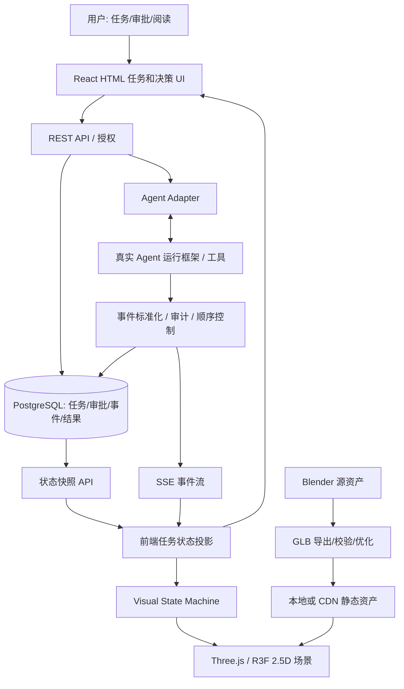

# Agent Office — 2.5D AI Agent 工作空间技术架构

> **B1 首版范围（2026-11-06）：** 当前代码仅为 `web/` 的 React / DOM / SVG 图片式 Demo。本文 3D、生产和后端内容保留为目标及历史设计依据；旧工具、模型与评审证据未随版，不可据此认定可运行或已获下一阶段授权。最新事实见 [当前状态](production/CURRENT_PROJECT_STATE.md)。文中“本轮 / 当前”的旧阶段记录按原记录日期理解。

> Status: ACTIVE · 2026-11-05 · 当前维护；范围以项目状态和唯一流水线为准。 [当前入口](production/CURRENT_PROJECT_STATE.md)

**更新** 2026-11-05 · **范围** 产品系统与事件架构；后端部分为后续设计，非已实现证明。

当前 A1.1 视觉、G2.4 人物外观高模和已批准办公室已锁定。阶段与授权取 [当前状态](production/CURRENT_PROJECT_STATE.md)，资产制作取 [唯一流水线](production/AI_3D_PIPELINE.md)，不得从本文重新开始 P0 或选风格。保留架构原路径以免破坏引用。

## 1. 产品目标与非目标

**目标**：让普通人从视觉上感知 Agent 的工作、协作、阻塞与交付，在同一产品中完成任务安排、结果阅读和关键决策。第一眼富有吸引力，但状态必须真实且可解释。

**用户闭环**：下达目标 → 任务分配/计划 → Agent 真实运行 → 状态可视化 → 阻塞/审批 → 成果展示 → 用户决策/下一轮任务。

**非目标（第一版）**：开放世界漫游、多人在线游戏、物理引擎、复杂自由建造、完全依赖 AI 实时生成动画、全面替代专业 3D 美术人员、运行端依赖本地 Blender。

**重要原则**：动画是对真实事件的表达，不是业务事实来源。展示真实结果和证据比人物移动更重要。

## 2. 当前已知环境、未验证事项

当前独立入口为 `web/index.html`，React / TypeScript / Vite 使用 PNG、DOM 和 SVG。原 R3F viewer、环境兼容入口和 G2.4 检查页仅在本机归档，未随版发布；无 Agent 后端。下表为保留的目标栈，不能当作本版依赖清单。

## 3. 已选技术栈（实现时锁定已测版本）

| 层 | 默认方案 | 边界/备注 |
| --- | --- | --- |
| 工程执行 | Codex 桌面端 + 项目 AGENTS.md + 项目 Skill | Codex 编程、运行、调试；不代替美术验收 |
| 场景制作 | 本地 Blender + Blender MCP + Blender Python CLI | MCP 交互创作；CLI 用于可重复导出 |
| 概念 / UI | Figma + MCP（可选） | 仅按任务需要用于 2D 设计；A1.1 已锁定 |
| 3D 交换 | glTF 2.0 / GLB、源文件 `.blend` | `.blend` 保持可编辑；GLB 用于 Web |
| 资源检查 | 自带 `inspect_glb.py` + Khronos glTF Validator | 前者快速结构检查，后者标准符合性 |
| 资源优化 | glTF Transform；需要时 Meshopt / KTX2 | 优化前后都检查渲染和动画 |
| 3D Web 渲染 | Three.js + React Three Fiber + Drei | 使用已发布稳定版本；首版以 WebGL 为基线 |
| 应用 | React + TypeScript + Vite | UI/3D 统一前端，但逻辑分离 |
| 客户端 | Zustand（仅 UI/视觉态）+ TanStack Query（服务端快照） | 避免两套互相冲突的任务“真相” |
| API | Node.js + TypeScript（可调整框架） | 所有密钥与审批权限仅在服务端 |
| 数据库 | PostgreSQL（P2 后接） | 任务、状态快照、事件、审批、成果元数据 |
| 实时事件 | REST + SSE（优先），需要时 WebSocket | SSE 用于单向状态推送；REST 提交用户操作 |
| 测试 | TypeScript 测试 + Playwright + GLB 检查 + 人工视觉验收 | 非确定性动画截图需锁定时间/帧 |
| Agent | Adapter 层对接已有/未来的 Agent 框架 | 不要求 Agent 知道 Blender 或 Three.js |

兼容提示：复用已锁定并通过构建的 React / R3F / Three.js 组合；版本升级须有任务依据并验证兼容性。当前使用 WebGL，不引入未验证的渲染路径。

## 4. 逻辑架构



**职责**：
- Agent 运行层：运行工具/模型、做任务决定、响应暂停/授权；不调用浏览器动画。
- API 和 Adapter：接受真实任务和审批请求，校验身份/权限，转换不同 Agent 框架事件。
- 事件/存储：事件有唯一 ID 和明确顺序；可查询、审计和恢复；成果保存为单独的受控资源。
- 前端投影：根据快照与增量事件还原任务和 Agent 状态；不从动效推断业务事实。
- 视觉状态机：将“研究中”等状态映射到行走/阅读/手势/镜头；动画可取消、跳过和恢复。
- 3D 层：只负责空间、人物、动画、交互锚点；复杂文字、报告和审批在 HTML。

## 5. 2.5D 场景与交互

- 使用**真正 3D 模型** + `OrthographicCamera` 形成 2.5D 观感，而不是给每个动作绘制 2D 精灵图。
- 初始摄像机：近等距倾角可从约 35° 俯视、45° 方位作为参数起点试验；最终根据人物可见性和构图调整，不把数值写死在模型里。
- 固定主要方向，允许有限平移、缩放和点击角色聚焦；不用第一人称 WASD 导航。
- 当前沿用批准办公室与固定正交评审镜头；正式人物、任务前台、审批/成果交互按后续授权范围逐步接入。
- 3D 中的人物、工位、任务提示可点选；可访问的 HTML 面板展示真实执行日志、来源、报告、批准/拒绝操作。
- 把 `office scene` 设计成可替换资源集，不把家具网格写成无法复用的硬编码场景。
- 场景 UI 的状态标签支持颜色之外的图标/文本，以免只靠颜色区分。

## 6. 事件契约（v1）

细节见 `.agents/skills/agent-office-runtime-integration/references/event-contract.md`。核心示例：

```json
{
  "schemaVersion": 1,
  "eventId": "evt-0003",
  "workspaceId": "demo-workspace",
  "taskId": "task-001",
  "agentId": "agent-research",
  "sequence": 3,
  "type": "agent.activity.started",
  "activity": "research",
  "occurredAt": "2026-11-04T10:00:03Z",
  "payload": { "summary": "正在检索资料", "traceRef": "trace-001" }
}
```

契约要求：`sequence` 在**单个 taskId 内**严格递增；同一任务的不同 Agent 共用此顺序空间。`eventId` 幂等去重；`occurredAt` 表示事件时间；`traceRef` 是引用，不是敏感日志全文。服务端状态及事件存储为权威来源。事件 `payload` 必须分类型校验，业务数据不可直接拼到 HTML 或任意执行脚本。

标准任务阶段：`queued`、`planning`、`running`、`awaiting_approval`、`blocked`、`completed`、`failed`、`cancelled`；客户端网络状态 `offline/unknown` 单独表示，不假装是真实 Agent 业务状态。

活动（不是任务完成度）：`planning`、`research`、`analysis`、`drafting`、`coding`、`review`、`handoff`、`none`。某 Agent 可以有多个工作事件，但前端应由投影逻辑选择当前可视活动。没有可信依据时不展示百分比完成进度。

**重连**：先取服务端快照及其每任务最近 `sequence`，再订阅/补齐后续事件；重复丢弃、乱序缓存/重新拉取、检测缺口后恢复快照。SSE 的重连能力不是后端事件持久化的替代品。

**审批**：所有批准/拒绝为服务端授权操作，带幂等键、审计记录；只有后端确认后前端才显示“已批准”，不能仅修改本地角色动画。

## 7. 视觉状态机与动画

采用 **两套互相独立、通过事件映射连接的状态机**：
1. **业务状态**：Agent/任务真实进展；由后端事件确定。
2. **视觉状态**：人物位置、姿态、动作剪辑、道具挂点、过渡和镜头；可短暂排队完成一段动作，但不能延迟必须立即显示的审批/错误信息。

事件流 → 任务状态投影 → 视觉计划器 → 路径点/动画队列 → Three.js `AnimationMixer`。

动画语义与本次 manifest 对齐；实际 Clip、表情和过渡按当前工作包约定，不能从旧示例名称推断已有实现或强制动作数量。资产制作和验收由生产流水线及质量关卡维护。

- 角色骨骼动画（GLB Clips）由 AnimationMixer 控制；空间移动路径、物品交接和镜头用 Three.js 代码。
- 一次性动作（接任务、站起、交付）与循环动作（阅读、工作）分开。
- 若有多个相同骨骼模板角色，使用 SkeletonUtils.clone 或其它可验证的独立骨骼实例化机制。
- 动画来自实际业务状态变化，不允许用“敲键盘动画”自动暗示任务已推进。
- 场景恢复时可以直接设置到正确位置/状态，不必重演已经过去的全部走路动画。

## 8. 资产制作与发布管线

唯一正式流程见 [AI_3D_PIPELINE.md](production/AI_3D_PIPELINE.md)，验收与资源预算见 [QUALITY_GATES.md](production/QUALITY_GATES.md)。本架构不再维护第二套模型、材质或动作生产规则。

运行端只消费登记的版本化资源。原外观高模、Blender 可编辑工作源、未压缩导出和 Web 优化副本职责不同；不能将高模诊断页当动画资产验收。3D 节点与业务 ID 解耦，模型接口变更同步 manifest 和消费者。

## 9. 数据模型（初版建议）

| 表/资源 | 主要字段 |
| --- | --- |
| `workspaces` | id, owner, configuration |
| `agents` | id, workspace_id, adapter_type, display_label, enabled, avatar_asset_id |
| `tasks` | id, workspace_id, title, status, owner, created_at, updated_at |
| `task_events` | event_id, task_id, sequence, agent_id, type, activity, payload, occurred_at |
| `task_snapshots` | task_id, last_sequence, projected_status, agent_state, updated_at |
| `approvals` | id, task_id, requested_by, status, decided_by, decided_at, audit_payload |
| `artifacts` | id, task_id, media_type, storage_key, checksum, created_at |
| `asset_versions` | asset_id, glb_path, source_ref, version, status |

示意而非最终 SQL 迁移文件。多租户访问控制、事件保留、存储成本、删除和隐私需求需要在 P2 细化。

## 10. 安全与隐私

- 模型 API Key / 工具凭据只放在后端；浏览器不持有服务端密钥。
- 执行日志、检索内容、报告和用户上传文件按任务/工作区权限隔离；可视化面板按需脱敏。
- 审批真实执行于后端并留审计；禁止用前端 `approved=true` 替代授权。
- Blender MCP 可以执行 Python，属于高权限本地开发工具：仅连接可信本机实例、隔离项目路径、不要让未知脚本读取密钥/私有文件、不对公网开放端口。
- 引入第三方 3D 资产必须记录来源、许可证、归属及是否允许商业使用和再分发。

## 11. 性能与降级：都是目标，不是已验证结果

角色并存数、分辨率、帧时间和资源预算在获授权工作包中按目标设备确认，统一遵循生产质量关卡；历史 5–8 人、60/30 FPS 是方向性估算，不是当前强制预算或性能承诺。

可执行手段：静态场景复用 geometry/material、减少 Draw Calls、合理使用贴图 atlas / 压缩、限制实时光源与阴影、角色动画独立化、网络/缓存控制、视口不可见时降帧或暂停、低性能设备切换静态简化场景/2D 任务视图。

当前资源测试记录设备/浏览器、GLB 体积与加载结果；正式性能验收按质量关卡的目标设备与工作包预算进行。

## 12. 测试金字塔与发布前验收

以下为产品逐步完善时的检查范围；动作、业务交互和可靠性测试随相应授权功能加入，当前资产验收统一取质量关卡。

| 层级 | 验证 |
| --- | --- |
| 静态契约 | TypeScript 类型检查、事件样本/资产 manifest、文件存在性 |
| GLB 结构 | 动画名/骨骼/材质/纹理检查、Khronos Validator |
| Blender 视觉 | 正视、等距、背面/顶视截图；人物变形、家具穿插、坐姿对齐 |
| 前端交互 | Playwright 点击工位/角色/任务、审批面板、事件重放 |
| 状态可靠性 | 断线恢复、重复/乱序、任务取消、失败、审批拒绝 |
| 体验与美术 | 人工判断第一眼吸引力、角色辨识、清晰度、报告可读性 |
| 性能 | 标准设备固定镜头脚本、帧率/内存与加载体积对比 |

3D 截图测试应固定随机种子、动作时间、场景视角、画布尺寸与 DPR，避免动效噪声造成不稳定截图。实际验证在浏览器而非只在 Blender 中进行。

## 13. 工程目录建议

```text
agent-office/
├── AGENTS.md
├── docs/
├── .agents/skills/
├── apps/
│   ├── web/src/{scene,animation,ui,stores,services}/
│   └── api/src/{adapters,events,tasks,approvals,storage}/
├── packages/contracts/
├── assets/{source,exported,manifests,previews}/
├── fixtures/
└── tests/
```

上述是目标组织方式；已有源资产和 viewer 真实存在，但 apps/web、apps/api 尚未实现。不因目录建议迁移现有工程。

## 14. 分阶段实施

后续产品演进见 [IMPLEMENTATION_ROADMAP.md](IMPLEMENTATION_ROADMAP.md)，当前范围见 [CURRENT_PROJECT_STATE.md](production/CURRENT_PROJECT_STATE.md)。资产流程与业务接入分开授权，不自动从静态评审进入完整功能建设。

## 15. 资料与参考（核对官方文档，注意版本变化）

- OpenAI Codex Skills: https://learn.chatgpt.com/docs/build-skills
- OpenAI AGENTS.md: https://learn.chatgpt.com/docs/agent-configuration/agents-md
- Blender MCP 社区仓库（Codex 使用及本地安装）：https://github.com/ahujasid/mcp-for-blender
- Blender 命令行与 Python： https://docs.blender.org/manual/en/latest/advanced/command_line/arguments.html
- Blender glTF 动画/Action/NLA 最新说明： https://github.com/KhronosGroup/glTF-Blender-IO/blob/main/docs/blender_docs/scene_gltf2.rst
- R3F: https://r3f.docs.pmnd.rs/
- Three.js SkeletonUtils: https://threejs.org/docs/pages/module-SkeletonUtils
- glTF Transform CLI: https://gltf-transform.dev/cli
- Khronos glTF Validator: https://github.com/KhronosGroup/glTF-Validator
- gltfjsx: https://github.com/pmndrs/gltfjsx
- Playwright screenshots: https://playwright.dev/docs/test-snapshots

## 16. 需要进一步确认的项目问题

- 实际 Blender 与 Codex 客户端版本、显卡/目标设备。
- 已有 Agent 系统是什么，是否提供事件流/审批接口？
- 首版针对哪类真实任务（研究、写作、运营、开发）？
- 美术预算、素材版权策略、是否有 3D 动画人员，以及目标美术品质样片。
- 多人协作、工作区权限、隐私数据保存周期与发布部署环境。

这些问题在相应后续工作包中解决，不影响本轮文档审计，也不授权开始新的样板或业务功能。
